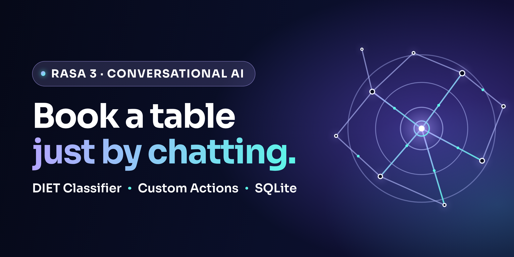
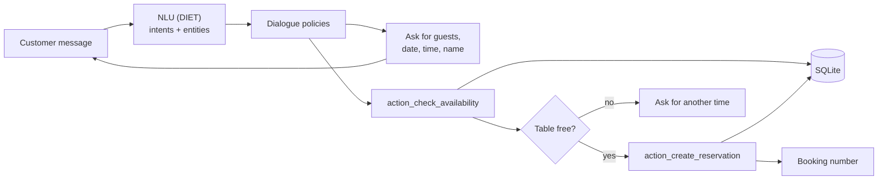

<p align="center">
  
</p>

# Restaurant Reservation Assistant

A Rasa 3 chatbot that takes table reservations in Arabic. It asks for the number of guests, the date,
the time and a name, checks a SQLite database for a free table, and gives back a booking number.

## What it handles

- Greetings, goodbyes, yes/no answers and the booking request itself
- Arabic number words (شخصين، ثلاثة), "اليوم" and "غدا", and times like "8 مساء", which get converted before the availability check
- Picking the smallest table that fits the group
- Telling the customer when nothing is free at that time

## How it works



The NLU pipeline is a DIET classifier on top of word and character n-gram features (the char n-grams
help with spelling variations in Arabic). Dialogue runs on RulePolicy, MemoizationPolicy and TEDPolicy.
The two custom actions in `actions/actions.py` call `database.py`, which has the schema and the booking logic.

## Project layout

```
restaurant_Chatbot_assistant/
├── actions/actions.py      # check availability, create reservation
├── data/
│   ├── nlu.yml             # Arabic training examples
│   ├── rules.yml
│   └── stories.yml
├── docs/sample-conversation.md
├── tests/test_stories.yml
├── config.yml              # pipeline and policies
├── domain.yml              # intents, entities, slots, responses
├── endpoints.yml           # action server and tracker store
├── database.py             # SQLite schema + availability and booking logic
└── requirements.txt
```

## Running it

You need Python 3.8 to 3.10, since Rasa 3 doesn't support newer versions.

```bash
git clone https://github.com/Marwankhater/restaurant_Chatbot_assistant.git
cd restaurant_Chatbot_assistant

python -m venv .venv && source .venv/bin/activate
pip install -r requirements.txt

python database.py   # creates restaurant.db with a few sample tables
rasa train
```

Then, from the project root, start the action server in one terminal:

```bash
rasa run actions
```

and chat with the bot in another:

```bash
rasa shell
```

`rasa test` runs the test stories.

## Example

<div dir="rtl">

| | |
|---|---|
| 👤 | أريد حجز طاولة |
| 🤖 | لكم شخص تريد حجز طاولة؟ |
| 👤 | 2 أشخاص |
| 🤖 | في أي تاريخ تريد الحجز؟ |
| 👤 | اليوم |

</div>

The full conversation is in [docs/sample-conversation.md](docs/sample-conversation.md).

## Ideas for later

- Web chat through Rasa's REST channel
- Cancelling or changing a booking
- More dialects (Egyptian, Gulf)

---

Made by [Marwan Khater](https://www.linkedin.com/in/marwan-ashraf-811660219/) · [GitHub](https://github.com/Marwankhater)
