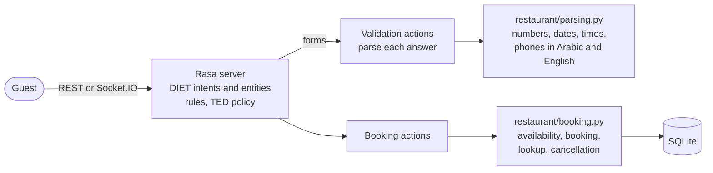

<p align="center">
  
</p>

# Restaurant Reservation Assistant

[](https://github.com/Marwankhater/restaurant_Chatbot_assistant/actions/workflows/ci.yml)

A Rasa 3 assistant that books, looks up and cancels restaurant tables in Arabic, including the
Egyptian dialect, with English understood too. It asks only for what is missing, reads answers the
way people actually write them ("احنا تلاتة", "بكرة 9 بالليل", "8 ونص", "٠١٠١٢٣٤٥٦٧٨"), checks
the real table plan before confirming, and never books the same table twice.

## Results

| Check | Result |
|---|---|
| Booking logic and actions (`pytest`) | 92 tests passing |
| Whole conversations against the running bot (`tests/e2e`) | 5 of 5 |
| Story tests (`rasa test core`) | 5 of 5 stories, 12 of 12 actions |
| Intent accuracy on 49 held-out sentences never seen in training | 0.918 (macro F1 0.912) |

The held-out sentences in `tests/nlu_test.yml` are written separately from the training data,
in the same mix of Modern Standard Arabic, Egyptian Arabic and English. CI retrains the model and
reruns all of the above on every push.

## How it works



**Booking.** A form collects party size, day, time, name and mobile number. Anything the guest
already said in the first message ("احجزلي ترابيزة لاتنين بكرة 9 بالليل") is used, and only the
rest is asked. The bot then checks a table, repeats the booking back, and books only after a yes.

**Looking up and cancelling.** A second form asks for the booking code and the mobile number used
to book. Both must match: a code on its own reveals nothing.

**Opening hours** can be asked at any point, including in the middle of a booking, which then
carries on where it stopped.

## Engineering decisions

**The booking rules live outside Rasa.** `restaurant/` is plain Python with no Rasa import, so
the rules that matter most (who gets which table, when) are tested directly and quickly, and
could sit behind a WhatsApp or web channel without change. The Rasa actions only translate.

**A table is free when no seating overlaps.** Each booking holds its table for the seating length
(two hours by default). The original version only compared start times as text, so 8:00 and 8:30
could land on the same table.

**No double booking under load.** The availability check and the insert run inside one SQLite
write transaction (`BEGIN IMMEDIATE`). A test fires eight requests for the last table at the same
moment and exactly one succeeds. If someone takes the table between the confirmation question and
the guest's yes, the guest gets the nearest free times instead of an error.

**Nothing is guessed.** An answer the bot cannot read is asked for again, with an example. The
original version silently fell back to two guests or 8 pm. When the form has asked for a value,
the whole message is parsed, so "3 الفجر" is read as 3 am (and refused, outside opening hours)
rather than an entity extractor's partial "3".

**Specific replies.** A day that has passed, a date beyond the booking horizon, a time outside
opening hours, a party larger than any table, or a full slot each get their own answer, and a full
slot comes with the nearest free times that day.

**Unguessable codes, and Arabic that reads right.** Booking codes are random (`R-48213`), not a
running number. Party sizes follow Arabic number agreement ("لشخصين", "لـ 3 أشخاص").

## Running it

With Docker (trains the model on first start):

```bash
docker compose up -d --build
```

Without Docker, on Python 3.10:

```bash
python -m venv .venv && source .venv/bin/activate
pip install -r requirements.txt
rasa train
rasa run actions                                   # terminal 1
rasa run --enable-api --credentials channels.yml   # terminal 2
```

Then talk to it over REST:

```bash
curl -s localhost:5005/webhooks/rest/webhook -H "Content-Type: application/json" \
  -d '{"sender": "me", "message": "عايز أحجز ترابيزة لتلاتة بكرة"}'
```

or with `rasa shell`.

### Settings

| Variable | Default | |
|---|---|---|
| `RESTAURANT_DB` | `restaurant.db` | SQLite file for bookings |
| `RESTAURANT_TZ` | `Africa/Cairo` | Time zone for "today" and "tomorrow" |
| `RESTAURANT_OPENS`, `RESTAURANT_LAST_SEATING` | `12:00`, `22:00` | First and last bookable start time |
| `RESTAURANT_SEATING_MINUTES` | `120` | How long a booking holds its table |
| `RESTAURANT_HORIZON_DAYS` | `60` | How far ahead guests can book |
| `RESTAURANT_TABLES` | `1:2,2:2,3:4,4:4,5:4,6:6,7:8` | Table number and seats |

## Tests

```bash
pip install -r requirements-dev.txt
pytest --ignore=tests/e2e                     # booking logic, parsing and actions
rasa test core --stories tests/test_stories.yml
rasa test nlu --nlu tests/nlu_test.yml        # held-out intent accuracy
RASA_URL=http://localhost:5005 pytest tests/e2e   # whole conversations, bot running
```

## Project layout

```text
restaurant/
  parsing.py        numbers, dates, times, phones and codes, in Arabic and English
  booking.py        table plan, overlap-aware availability, atomic booking, lookup, cancel
  settings.py       opening hours, seating length, tables, from environment variables
actions/actions.py  form validation and booking actions (thin adapters over restaurant/)
data/               training data: NLU, rules, stories
domain.yml          intents, entities, slots, forms, responses
config.yml          pipeline (DIET with character n-grams) and policies
tests/              unit, action, story, held-out NLU and end-to-end tests
```

## Limitations

- One restaurant and one table plan per deployment.
- SQLite suits a single action server. Several replicas would need PostgreSQL; the booking code
  already does the check and insert in one transaction, so moving it is a contained change.
- The bot replies in Modern Standard Arabic. It understands Egyptian Arabic, but other dialects
  have only a few training examples.

The full sample conversation is in [docs/sample-conversation.md](docs/sample-conversation.md).

---

Made by [Marwan Khater](https://www.linkedin.com/in/marwan-khater-811660219/) · [GitHub](https://github.com/Marwankhater)
